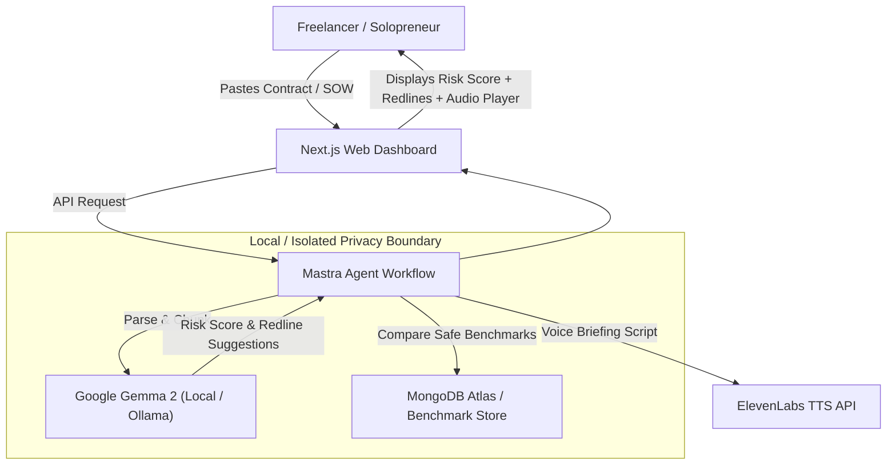

# ClauseGuard AI 🛡️
> **Privacy-First Freelancer Contract & Risk Auditor**  
> *Built for the Hacktoberfest 2026 Open-Source AI Challenge: Week 2 ("Side Hustle")*

---

## 🎯 The Side Hustle Problem & Opportunity

**1.5 billion freelancers and independent contractors** face a recurring dilemma: every new client hands them a dense Master Services Agreement (MSA), SOW, or NDA packed with legal jargon.
- **The Pitfalls:** Uncapped indemnification liability, Net-90 delayed payment terms, forfeiture of pre-existing code/tools, and blanket non-competes.
- **The Dilemma:** Hiring a legal counsel costs **$300–$600/hour**, which is financially out of reach for independent professionals.
- **The SaaS Trap:** Uploading client agreements to public cloud LLMs (OpenAI, Anthropic) **directly violates the Non-Disclosure Agreements (NDAs)** freelancers sign with their clients.

### The Solution: `ClauseGuard AI`
ClauseGuard is an autonomous legal auditor tailored for freelancers. It ingests contracts, flags predatory clauses, evaluates legal risk (0–100 score), and generates copy-paste redline counter-offers in plain English—alongside a 45-second voice briefing for quick audio reviews.

**Willingness to Pay:** Freelancers happily pay a micro-subscription of **$9–$15/month** or **$5/contract audit** to protect their livelihood and avoid catastrophic liability.

---

## 💡 Why Open Innovation Matters (The Core Hackathon Prompt)

1. **Strict Data Privacy & Legal Compliance:**  
   Because ClauseGuard runs **Google Gemma 2** locally via Ollama or in private isolated containers, **zero client contract data ever leaves the user's laptop**. This satisfies the strict confidentiality mandates of commercial NDAs.
2. **Zero Marginal Inference Cost:**  
   Auditing 40-page PDFs with commercial cloud LLMs runs high token costs per user. Open-weight inference delivers near-zero marginal operational cost, making a low-cost $9/mo micro-SaaS commercially viable.
3. **No Vendor Lock-in or Model Depreciation:**  
   Using open weights prevents reliance on volatile proprietary pricing tiers or unexpected model behavior changes.

---

## 🏆 Hackathon Sponsor Track Alignment

- **Best Use of Gemma ($200):** Leverages **Gemma 2 (9B/2B)** for deep legal text comprehension, risk scoring, and redline negotiation generation.
- **Best Use of Mastra ($100):** Orchestrates multi-step agent pipelines: text segmentation ➔ safe benchmark comparison ➔ Gemma risk evaluation ➔ redline counter-offer synthesis.
- **Best Use of MongoDB Atlas ($100):** Stores vector embeddings of fair contract standards and historical audit reports.
- **Best Use of ElevenLabs ($100):** Synthesizes a 45-second executive voice briefing summarizing high-risk traps.
- **Best Use of Render ($200):** Designed for zero-downtime 1-click cloud deployment on Render.

---

## 🏗️ Architecture



---

## 🚀 Getting Started

### 1. Prerequisites
- [Node.js](https://nodejs.org) (v18+)
- [Ollama](https://ollama.com) (Recommended for 100% local privacy)

### 2. Pull Gemma 2
```bash
ollama run gemma2:9b
# Or the ultra-lightweight version:
# ollama run gemma2:2b
```

### 3. Clone & Install
```bash
git clone https://github.com/your-username/clauseguard-ai.git
cd clauseguard-ai
npm install
```

### 4. Configure Environment
Copy `.env.example` to `.env.local`:
```bash
cp .env.example .env.local
```
*(All API keys are optional! ClauseGuard automatically falls back to local heuristics and browser speech synthesis if keys are not provided.)*

### 5. Run Development Server
```bash
npm run dev
```
Open [http://localhost:1093](http://localhost:1093) in your browser.

---

## 📄 License
This project is open-source under the [MIT License](LICENSE).
